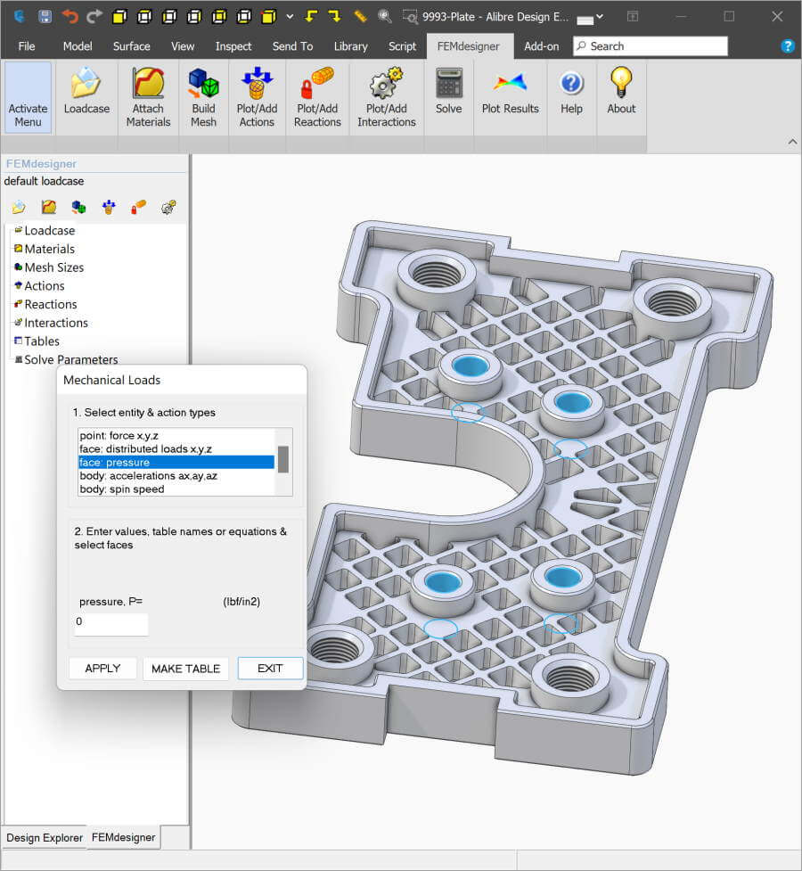
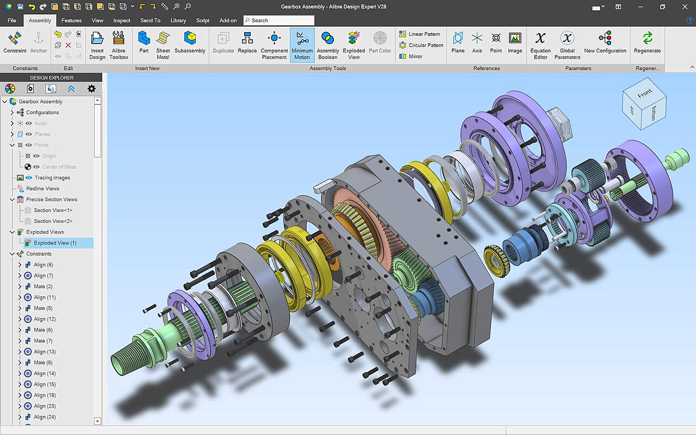
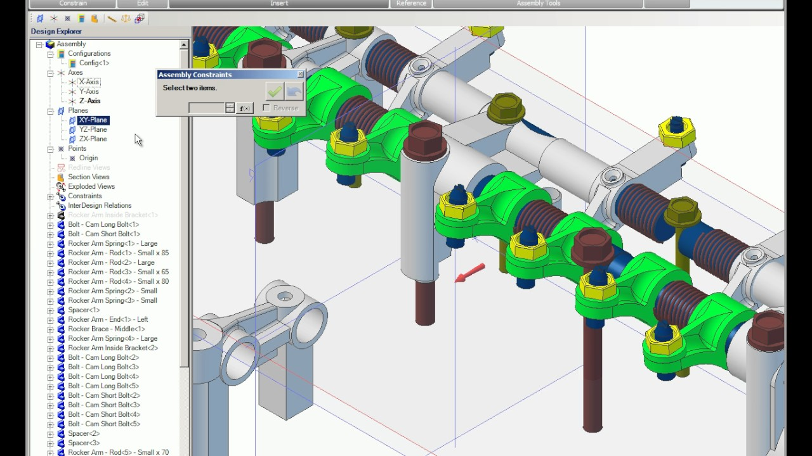

# Alibre Design Parametric Mechanical CAD Workflow Guide

[](https://alibre-design.github.io/alibre-atom3d/)

Alibre Design is a Windows-based parametric CAD system for creating mechanical parts, assemblies, manufacturing drawings, sheet-metal components, and product documentation.

The product family includes Alibre Atom3D for personal projects and Alibre Design Professional or Expert for broader engineering workflows.

This repository is an independent informational resource.

It is not an official Alibre repository and does not contain Alibre's proprietary source code, installers, licenses, or activation components.

## Overview

The alibre design workflow begins with dimensioned sketches that become three-dimensional features.

Designers can extrude, revolve, cut, pattern, mirror, and combine geometry while retaining editable dimensions and relationships.

Changes to an early dimension can propagate through later features, assemblies, and associated drawings.

Typical uses include:

- Mechanical part design.
- Multi-component assemblies.
- Production drawings.
- 3D-printing models.
- CNC-ready geometry.
- Sheet-metal components.
- Weldment structures.
- Product visualization.
- Design automation.

## Product Editions

Alibre provides editions for different project sizes and professional requirements.

| Edition | Intended use | Selected capabilities |
| --- | --- | --- |
| Atom3D | Makers and personal projects | Basic modeling, drawings, 3D printing, and CNC geometry |
| Design Professional | Everyday mechanical engineering | Core modeling, assemblies, drawings, scripting, and extended formats |
| Design Expert | Complete product-development workflow | Advanced modeling, sheet metal, weldments, configurations, PDM, and rendering |

The exact feature set should be checked against the current edition comparison.

Alibre Design Expert includes capabilities that are not available in Professional or Atom3D.

## Parametric Modeling

Parametric modeling records dimensions, constraints, and feature relationships as design intent.

A sketch can define the profile of a part, while later features determine its thickness, holes, fillets, patterns, and other details.

A controlled workflow is:

1. Establish suitable reference planes.
2. Create a simple constrained sketch.
3. Add dimensions that express design intent.
4. Generate the first solid feature.
5. Add secondary features in a stable order.
6. Test important dimensions before detailing.
7. Rename key features for easier maintenance.



The downloaded reference project demonstrates constructive geometry in [CSG.scad](examples/Basics/CSG.scad).

Its [linear_extrude.scad](examples/Basics/linear_extrude.scad) and [rotate_extrude.scad](examples/Basics/rotate_extrude.scad) examples illustrate two general methods for turning profiles into solids.

These files belong to OpenSCAD and do not describe Alibre's implementation.

## Sketches and Constraints

Well-constrained sketches are easier to edit predictably.

Constraints can define horizontal and vertical directions, equality, tangency, concentricity, symmetry, distances, and angles.

Prefer a small number of meaningful dimensions over repeated measurements that describe the same relationship.

Before completing a sketch, check:

- Whether its origin has a deliberate purpose.
- Whether important geometry remains under-defined.
- Whether redundant constraints are present.
- Whether dimensions reflect manufacturing intent.
- Whether construction geometry should replace solid lines.

A robust sketch should respond predictably when its driving dimensions change.

## Features and Design Intent

Feature order affects how a model reacts to revisions.

Create the main form before adding small holes, cosmetic fillets, chamfers, or text.

Reference stable planes and axes when possible.

The open reference [projection.scad](examples/Basics/projection.scad) demonstrates projection as a general CAD concept.

[text_on_cube.scad](examples/Basics/text_on_cube.scad) provides a separate example of generating raised or recessed text geometry.

Do not treat OpenSCAD syntax as Alibre Script or Alibre feature history.

## Assemblies

An assembly combines individual parts and subassemblies.

Constraints establish how components are positioned and how permitted movement behaves.

A useful assembly workflow includes:

- Grounding or fixing one reference component.
- Adding large structural components first.
- Applying only the constraints needed to locate each part.
- Testing movement before adding detail.
- Reusing subassemblies for repeated mechanisms.
- Reviewing interference and clearances.
- Assigning clear part numbers.

Large assemblies benefit from consistent origins, simplified hardware, and disciplined file organization.

## Motion and Mechanical Relationships

Assembly motion can reveal incorrect constraints, insufficient clearances, and unrealistic component placement.

Movement should be tested throughout the intended range, not only in one position.

Atom3D supports realistic movement for suitable personal projects, while edition-specific tools determine the available professional workflow.

Motion checks do not replace engineering analysis.

Loads, deformation, fatigue, tolerances, lubrication, and manufacturing variation may require dedicated calculations or specialist tools.

## Production Drawings

A three-dimensional model communicates shape, while a production drawing communicates manufacturing requirements.

Drawing views may include orthographic, isometric, section, detail, auxiliary, and broken views.

A drawing should clearly document:

- Critical dimensions.
- Tolerances.
- Hole and thread information.
- Materials.
- Surface requirements.
- Part number and revision.
- Scale and projection method.
- Manufacturing notes.

Associative drawing views should be reviewed after every significant model change.



## Bill of Materials

Assembly drawings can use a bill of materials to identify components and quantities.

A reliable bill of materials depends on consistent component metadata.

| Property | Example purpose |
| --- | --- |
| Part number | Unique component identification |
| Description | Human-readable component name |
| Quantity | Number required by the assembly |
| Material | Manufacturing material |
| Revision | Controlled design state |
| Supplier | Purchased-component source |

Avoid using filenames as the only source of manufacturing identity.

## Equations and Global Variables

The Equation Editor can connect dimensions through mathematical relationships.

This is useful for clearances, proportional features, standard thicknesses, and families of related dimensions.

Global design variables in supported editions can coordinate values across multiple parts and assemblies.

Use descriptive variable names and document their units.

The reference [sign.scad](examples/Parametric/sign.scad) shows parameter-driven geometry in another CAD system.

Its related [sign.json](examples/Parametric/sign.json) stores named parameter sets, while [candleStand.scad](examples/Parametric/candleStand.scad) demonstrates another configurable model.

These are conceptual references only.

## Direct Editing

Direct editing can be useful when imported geometry has no editable Alibre feature history.

Supported Expert tools can move faces, change openings, or modify other geometric details without rebuilding the original feature sequence.

Use direct editing carefully when dimensional relationships must remain explicit.

For native parts, a controlled feature-history edit is often easier to understand later.

For imported parts, document every direct modification and retain the original source model.

## Sheet Metal and Weldments

Alibre Design Expert includes dedicated sheet-metal and weldment workflows.

Sheet-metal tools support bends, rips, radii, conversion of suitable solids, and flat-pattern preparation.

Weldment tools can create structural members from layouts and standard profiles.

Before release, verify:

- Material thickness.
- Bend radius and allowance.
- Relief geometry.
- Flat-pattern overlaps.
- Profile standards.
- Trimmed intersections.
- Cut-list information.
- Drawing orientation.

Fabrication rules should be confirmed with the selected manufacturer.

## File Interoperability

Alibre can exchange geometry through formats such as STEP, SAT, IGES, STL, OBJ, DWG, DXF, SVG, and edition-dependent native CAD formats.

Choose a format based on the downstream task.

| Format | Common purpose | Important consideration |
| --- | --- | --- |
| STEP | Solid-model exchange | Usually preferred for editable manufacturing geometry |
| STL | 3D printing | Mesh resolution affects surface quality |
| DWG or DXF | 2D manufacturing data | Confirm units, scale, and layer expectations |
| SVG | Sketch or cutting workflow | Verify curve interpretation |
| PDF | Documentation | Confirm drawing scale before printing |

Imported neutral geometry usually does not include the source application's parametric feature history.

## STEP and STL Handoff

STEP is generally more suitable for exchanging precise solid geometry.

STL approximates surfaces with triangles and is commonly used for additive manufacturing.

Inspect exported models before delivery.

Check orientation, units, holes, wall thickness, and whether the receiving application preserves the intended geometry.

The downloaded OpenSCAD reference uses [offset.scad](examples/Advanced/offset.scad) to demonstrate offset geometry and [module_recursion.scad](examples/Advanced/module_recursion.scad) to demonstrate reusable procedural construction.

## Related CAD Command Example

Alibre Design is primarily a graphical application and no Alibre CLI is represented in the downloaded files.

The following command belongs to OpenSCAD, the associated reference tool, and exports a script model to STL:

```bash
openscad -o output.stl input.scad
```

The syntax is documented in [openscad.1.in](doc/openscad.1.in).

The helper [create-stl.sh](scripts/create-stl.sh) wraps a related export operation, while [batch-examples-stl.sh](scripts/batch-examples-stl.sh) demonstrates batch processing in the reference project.

These commands are not Alibre commands.

## Export Review

A simple Windows file inventory can help review exported deliverables without modifying them:

```powershell
Get-ChildItem ".\Exports" -File |
  Sort-Object Name |
  Select-Object Name, Length, LastWriteTime
```

Keep native Alibre files together with neutral exports and released drawings.

A neutral export should not replace the editable design master.

## Export Integrity

File hashes can help determine whether released files have changed after approval.

This PowerShell example reads STEP and STL files and produces SHA-256 hashes:

```powershell
Get-ChildItem ".\Exports" -File |
  Where-Object Extension -In ".step", ".stp", ".stl" |
  Get-FileHash -Algorithm SHA256
```

Store the results with release records when traceability matters.

A hash verifies file identity, not geometric correctness.

## Automation and API

Alibre Design Professional and Expert provide Python-based Alibre Script functionality.

The Alibre application programming interface also supports integrations developed with C++, C#, or VB.NET.

Automation can assist with:

- Repeated geometry creation.
- Metadata updates.
- Batch exports.
- Assembly generation.
- Specialized engineering workflows.
- Connections to external business systems.
- Headless processing through supported API scenarios.

Validate generated designs and do not assume a script has produced manufacturable geometry merely because it completed successfully.

## Visualization

Edge display, selection feedback, and view navigation are important parts of a CAD interface.

The OpenSCAD reference renders edge-related data through [ViewEdges.vert](shaders/ViewEdges.vert) and [ViewEdges.frag](shaders/ViewEdges.frag).

[MouseSelector.vert](shaders/MouseSelector.vert) provides a compact example associated with graphical selection.

These shader files are unrelated to Alibre's proprietary rendering implementation.



## Rendering and Presentation

Alibre Design Expert includes photorealistic rendering for product communication, material studies, proposals, and documentation.

Rendering should be treated as a presentation output rather than proof that a design is ready for manufacture.

Confirm dimensions, materials, tolerances, and assembly behavior using engineering data.

Keep rendering materials and scene settings separate from manufacturing properties when their purposes differ.

## System Requirements

Current Alibre releases are 64-bit Windows desktop applications.

For a new workstation, Windows 11 is the recommended starting point.

Published guidance lists 8 GB of memory as a minimum and 16 GB as a practical recommendation.

A DirectX 11-capable graphics system is required, and complex assemblies or high-resolution displays can require additional graphics memory.

Single-core processor performance remains important for many geometry operations.

## Reference Build Files

The local source snapshot is from OpenSCAD, not Alibre.

Its Windows build process is represented by [win-msvc-build.bat](scripts/win-msvc-build.bat).

Use that file only when studying or building the corresponding OpenSCAD source tree.

It must not be presented as an Alibre build procedure.

## Version and Licensing Notes

At the time of this guide, the current public Alibre downloads identify version 29.1 SP1 for Alibre Design and Alibre Atom3D.

Lifetime, monthly, and yearly licensing options are available, but pricing, update coverage, and support terms can change.

Confirm current terms before purchasing or renewing a license.

Older project environments should be tested before updating production workstations.

## Troubleshooting

If a sketch changes unexpectedly, inspect missing, conflicting, or redundant constraints.

If an assembly will not move, check for excessive constraints and fixed components.

If an imported model behaves differently, verify units, format version, geometry quality, and import options.

If an STL appears faceted, review export mesh settings and compare the result with the native solid.

If a drawing is outdated, regenerate its views and inspect dimensions after changing the model.

If performance is poor, test a representative assembly, graphics settings, memory use, and single-core processor behavior.


## Related Search Terms

alibre design, alibre atom3d, alibre cad, alibre design software, alibre design expert, cad, 3d-modeling, parametric, mechanical-engineering, 3d-printing, cnc, step, stl, assemblies, technical-drawing, windows
